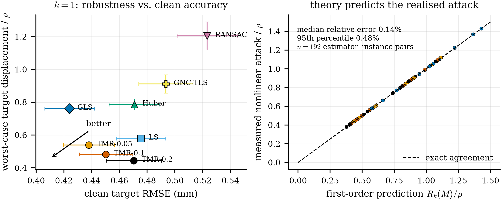
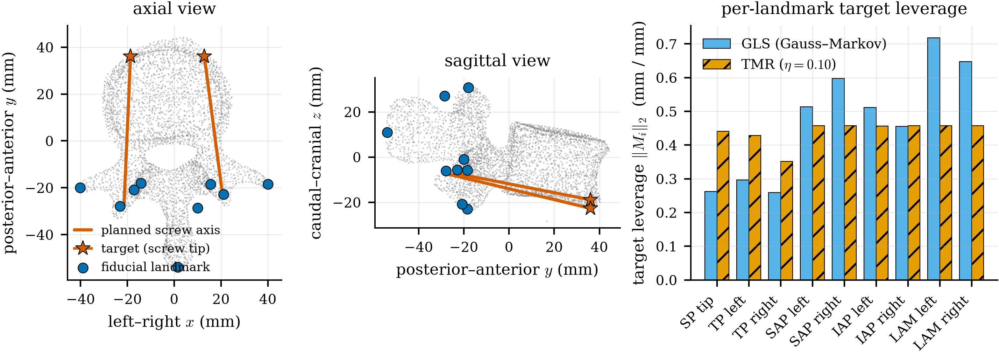

# Target-Minimax Registration (TMR)

Rigid paired-point registration that protects the point you actually care about.

In image-guided surgery a few fiducial landmarks are registered to a plan, and
the registration is then used to place an instrument at a **target**, such as a
pedicle-screw tip several centimetres from every landmark. Standard estimators
(least squares, Gauss–Markov weighting, Huber, RANSAC, GNC-TLS) minimise error
*at the fiducials*. TMR instead chooses the estimator that minimises the
**worst-case displacement of the target** when up to `k` landmark measurements
are corrupted by at most `ρ` mm each, subject to a budget `η` on how much clean
accuracy it may give up relative to the Gauss–Markov optimum.

The design reduces to a convex program over a 3×3n *target-influence operator*,
and the exact worst-case risk over all k-sparse corruptions collapses from a
combinatorial search to a maximisation over the 2-sphere.

Everything is CPU-only. There is no learned component and no patient data.



*Left: every estimator attacked directly as a black box (k = 1, mean over 8
random geometries × 3 corruption budgets, bars are ±1 standard error). TMR is the only method that
moves down and left of Gauss–Markov. Right: the closed-form risk predicts the
realised nonlinear attack to 0.14% median error.*

## Headline results

Ratios are paired per geometry; brackets are 95% percentile-bootstrap
intervals over geometries (B = 2000).

| Result | Value |
|---|---|
| Worst-case target displacement vs. Gauss–Markov, 10% clean-variance budget, k = 1 (720 random geometries) | **0.72×** [0.71, 0.73] |
| Same, k = 2 | 20% reduction [19%, 21%] |
| Under direct black-box attack: TMR (η = 0.10) vs. Gauss–Markov, k = 1 | 36% reduction [31%, 41%] for 6.2% [5.4%, 6.9%] clean RMSE |
| Unweighted LS vs. Gauss–Markov under attack (worst case per mm) | 0.58 vs. 0.76: GM weighting is *adversarially worse* |
| Margin over a learned correspondence-weighting baseline at its population optimum | 18% [14%, 20%] |
| L1 vertebra, transpedicular screw tip (real FE mesh, 9 landmarks, 66 mm lever arm) | 0.75 → 0.47 mm per mm of corruption, **37%** reduction (range 36–38%) |
| Advantage grows with fiducial count | 22% reduction at n = 5 → 54% at n = 40 |
| Misspecified noise covariance (δ = 0.8) | TMR's clean variance is 0.85× that of a misspecified GM design |
| Fraction of the GM-over-floor slack that TMR recovers | 73% [72%, 75%] |
| Where it helps least: minimum fiducial count n = 4 | 0.82× [0.80, 0.85] |

All 1,914 reported numbers are generated from `results/*.json` by
`experiments/make_tables.py`; none is typed by hand.



*The surgical instantiation: nine posterior landmarks on a published L1 mesh
and a transpedicular screw axis. TMR flattens the per-landmark leverage on the
target, which is what bounds the worst case.*

## Quick start

```bash
python3 -m venv .venv && source .venv/bin/activate
pip install -r requirements.txt

python3 tests/test_theory.py        # 20 numerical checks of the theory, ~2 min
python3 experiments/make_tables.py  # rebuild every number from the committed results
python3 experiments/make_figures.py # rebuild every figure
./run_all.sh                        # rerun all experiments from scratch (slow)
```

Using the library directly:

```python
import numpy as np
from tmr.geometry import stack_jacobians, target_jacobian
from tmr.estimators import gls_influence, tmr_influence
from tmr.risk import sparse_risk_exact

rng = np.random.default_rng(0)
P = rng.uniform(-60, 60, size=(7, 3))          # fiducials (mm)
x = np.array([0.0, 0.0, 80.0])                 # target (mm)
sig = 0.35 * np.exp(0.35 * rng.standard_normal(7))
Sigma = np.diag(np.repeat(sig**2, 3))          # localisation noise
rho = np.ones(7)                               # corruption budget per fiducial (mm)

A, G = stack_jacobians(np.eye(3), P), target_jacobian(np.eye(3), x)
M_gm = gls_influence(A, G, Sigma)
design = tmr_influence(A, G, Sigma, rho, k=1, eta=0.10)
print(sparse_risk_exact(M_gm, rho, 1), design.risk)   # worst-case target shift, GM vs TMR
```

## Layout

```
tmr/                  the estimator library
  geometry.py         SE(3) utilities and first-order registration Jacobians
  risk.py             exact worst-case target displacement under k-sparse corruption
  estimators.py       baselines (LS, weighted LS, Huber, RANSAC, GNC-TLS) and the TMR designs
  limits.py           estimator-independent limits (no unbiased estimator can beat them)
  anatomy.py          L1 vertebra geometry, landmarks and screw corridor from the FE mesh
experiments/          one script per experiment, plus table and figure generators
tests/test_theory.py  numerical verification of every theoretical claim
results/              raw JSON written by the experiments (committed)
figures/              generated figures (PDF + PNG)
outputs/latex/        generated LaTeX tables and number macros with CIs
data/                 L1–L2 lumbar FE mesh (CC-BY-4.0, see data/README.md)
```

## Experiments

| Script | Question | Output |
|---|---|---|
| `exp1_synthetic` | Robustness / clean-efficiency Pareto frontier on random geometries | `fig3_pareto` |
| `exp2_nonlinear` | Direct black-box attack on every estimator | `fig4_headtohead`, `main_results` table |
| `exp3_stealth` | Can the corruption be detected from fiducial residuals? | `fig2_stealth` |
| `exp4_ablations` | Six ablations isolating what TMR contributes | `fig5_ablations` |
| `exp5_vertebra` | Transpedicular screw placement on a real L1 vertebra | `fig6_vertebra`, `vertebra` table |
| `exp6_linearisation` | Validity range of the first-order displacement model | `linearisation` table |
| `exp7_factorial` | Minimax objective vs. design class (2×2 factorial, incl. learned weighting) | `factorial` table |
| `exp8_breach` | Medial pedicle-breach margin (scalar loss, limit attained exactly) | `breach` table |
| `exp9_limits` | Tightness of the estimator-independent limits | numbers |
| `exp10_scaling` | Does the benefit survive as the number of fiducials grows? | `fig7_robustness` |
| `exp11_sigma` | Misspecified noise covariance | `fig7_robustness` |
| `exp12_qiu` | Exact correspondence with Qiu et al. (2018) | numbers |
| `exp13_workspace` | A region of targets instead of a single point | numbers |
| `exp14_initpose` | Sensitivity of the SE(3) solver to its initial pose | numbers |
| `exp15_regime` | When does target-minimax design *not* help? | `fig8_regime` |
| `exp16_aniso` | Anisotropic (camera-axis) localisation noise | `fig9_aniso` |

Each script's docstring states its setup in full. All randomness is seeded.
The black-box attack experiments (2, 5, 16) take most of the runtime.

## Scope and limitations

All results are in simulation, on random geometries and on one real vertebra
mesh. There is no physical phantom or tracker experiment. The corruption model
is bounded and k-sparse, standing in for landmark misplacement and
mislocalisation; it is not a model of arbitrary gross outliers.

## Data

The vertebra geometry comes from the lumbar spine finite-element model at
[doi:10.5281/zenodo.3961334](https://doi.org/10.5281/zenodo.3961334)
(CC-BY-4.0), redistributed unmodified in `data/`.

## License

Copyright © 2026 Krishnan9074. All rights reserved.

The source code is published for reading and reference only. No license is
granted to copy, modify or redistribute it. The data in `data/` is
third-party and remains under its own CC-BY-4.0 license.
